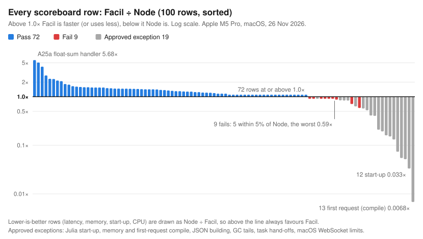

# Facil.jl

[](https://aryan-juliahub.github.io/Facil.jl/dev/)
[](https://github.com/aryan-juliahub/Facil.jl/actions/workflows/CI.yml)

An HTTP/1.1 server for Julia built on [facil.io](https://github.com/boazsegev/facil.io).
You write a function from a request to a response; Facil serves it, with
HTTPS, WebSockets, server-sent events, streaming, static files and compression.

```julia
using Facil

serve("127.0.0.1", 8080) do req
    Response(StatusCodes.OK, "hello")
end
```

- **facil.io** (C) does the sockets, the event loop, HTTP/1.1 parsing, static files,
  WebSockets, server-sent events, pub/sub, timers and TLS.
- **HttpTypes** (pure Julia, in `lib/HttpTypes`) supplies the request and response
  types. It is a port of the Rust [`http`](https://github.com/hyperium/http) crate,
  version 1.5.0, with the crate's validation rules and tests. Facil re-exports it.
- Facil is the Julia layer between them: handlers, threads, request bodies,
  streaming, compression.

HTTP.jl is not a dependency.

**Documentation: <https://aryan-juliahub.github.io/Facil.jl/dev/>**

| If you are | Start with |
|---|---|
| new to Facil | [Install](https://aryan-juliahub.github.io/Facil.jl/dev/getting-started/install/), [Your first server](https://aryan-juliahub.github.io/Facil.jl/dev/getting-started/first-server/), [Tutorial: a JSON API](https://aryan-juliahub.github.io/Facil.jl/dev/getting-started/tutorial/) |
| coming from HTTP.jl or Node.js | [Coming from HTTP.jl](https://aryan-juliahub.github.io/Facil.jl/dev/guide/from-http-jl/), [Coming from Node.js](https://aryan-juliahub.github.io/Facil.jl/dev/guide/from-node/) |
| looking something up | [API reference](https://aryan-juliahub.github.io/Facil.jl/dev/api/), [Configuration](https://aryan-juliahub.github.io/Facil.jl/dev/reference/configuration/), [FAQ](https://aryan-juliahub.github.io/Facil.jl/dev/reference/faq/) |

## Install

Facil is not registered yet, and the prebuilt C library (`facil_julia_jll`) is not
published. Until then, installing needs git, a C compiler (`clang` or `gcc`) and a
clone. `Pkg.add(url = ...)` does not work, because Pkg cannot fetch the facil.io
submodule.

```sh
git clone --recurse-submodules https://github.com/aryan-juliahub/Facil.jl
julia --project=Facil.jl -e 'using Pkg; Pkg.instantiate()'
julia --project=Facil.jl Facil.jl/deps/build.jl
```

Then, from your own project:

```sh
julia --project=. -e 'using Pkg; Pkg.develop([PackageSpec(path="../Facil.jl/lib/HttpTypes"), PackageSpec(path="../Facil.jl")])'
```

Julia 1.10 or later on Linux or macOS; CI tests Linux x86_64 and macOS (arm64 and
x86_64). Windows is not supported (facil.io has no Windows port): on Windows, run
Facil inside WSL2. HttpTypes (`lib/HttpTypes`) is pure Julia and works natively on
Windows. The [install page](https://aryan-juliahub.github.io/Facil.jl/dev/getting-started/install/) covers what can go wrong.

## Quick start

Save the five lines at the top of this page as `hello.jl` and run them with
more than one Julia thread:

```
$ julia -t 4 --project=. hello.jl &
$ curl http://127.0.0.1:8080/
hello
```

`serve` blocks until the server is stopped. `serve!` takes the same arguments
and returns a `Server` at once (`close(server)` stops it; port `0` picks a free
port, which is what tests want). A handler gets a `Request{String}` and returns
a `Response` (body `String`, `Vector{UInt8}` or `nothing`) or a `String`. A
handler that throws gives a 500.

By default a handler runs on a task of Facil's worker pool, on Julia's threads,
so it may block. `inline = true` runs handlers on the event-loop thread instead:
faster, but a handler that blocks then stalls every connection. With one Julia
thread, handlers always run inline. See
[Handlers and concurrency](https://aryan-juliahub.github.io/Facil.jl/dev/guide/handlers/).

There is no router; a handler branches on the method and the path:

```julia
using Facil

function app(req)
    m, p = method(req), path(uri(req))
    if p == "/"
        m == Methods.GET || return not_allowed("GET")
        Response(StatusCodes.OK, "home\n")
    elseif startswith(p, "/users/")
        m == Methods.GET || return not_allowed("GET")
        id = tryparse(Int, chopprefix(p, "/users/"))
        id === nothing && return Response(StatusCodes.BAD_REQUEST, "bad id\n")
        Response(StatusCodes.OK, "user $id\n")
    else
        Response(StatusCodes.NOT_FOUND, "not found\n")
    end
end

not_allowed(allow) = Response(StatusCodes.METHOD_NOT_ALLOWED, "method not allowed\n"; headers = [header.ALLOW => allow])

serve(app, "127.0.0.1", 8080)
```

WebSockets are accepted from the same handler:

```julia
using Facil

serve("127.0.0.1", 8080) do req
    Facil.is_upgrade(req) || return Response(StatusCodes.UPGRADE_REQUIRED, "WebSocket only";
                                             headers = [header.UPGRADE => "websocket"])
    websocket(req;
              on_open = ws -> send(ws, "welcome"),
              on_message = (ws, msg) -> send(ws, msg),
              on_close = ws -> println("client gone"))
end
```

Every code block in this README is a file in [`docs/examples`](docs/examples),
which the documentation build and the test suite start on a free port and check
with a client.

## What is in the box

| Feature | Guide |
|---|---|
| Task and inline handlers, reactor threads | [Handlers and concurrency](https://aryan-juliahub.github.io/Facil.jl/dev/guide/handlers/) |
| Reading requests; query strings; limits | [Reading requests](https://aryan-juliahub.github.io/Facil.jl/dev/guide/requests/) |
| Uploads: buffered, streamed, spooled to disk, rejected early | [Request bodies](https://aryan-juliahub.github.io/Facil.jl/dev/guide/bodies/) |
| Responses, redirects, headers | [Sending responses](https://aryan-juliahub.github.io/Facil.jl/dev/guide/responses/) |
| Routing without a framework; JSON | [Routing](https://aryan-juliahub.github.io/Facil.jl/dev/guide/routing/), [JSON](https://aryan-juliahub.github.io/Facil.jl/dev/guide/json/) |
| Chunked streaming and server-sent events | [Streaming](https://aryan-juliahub.github.io/Facil.jl/dev/guide/streaming/), [SSE](https://aryan-juliahub.github.io/Facil.jl/dev/guide/sse/) |
| Static files with ETag, ranges and `.gz` siblings | [Static files](https://aryan-juliahub.github.io/Facil.jl/dev/guide/static/) |
| zstd, brotli and gzip compression | [Compression](https://aryan-juliahub.github.io/Facil.jl/dev/guide/compression/) |
| WebSockets and process-local pub/sub | [WebSockets](https://aryan-juliahub.github.io/Facil.jl/dev/guide/websockets/), [Pub/sub](https://aryan-juliahub.github.io/Facil.jl/dev/guide/pubsub/) |
| HTTPS with SNI, client certificates, live certificate reload | [HTTPS](https://aryan-juliahub.github.io/Facil.jl/dev/guide/tls/) |
| Accurate timers and `Facil.sleep` | [Timers](https://aryan-juliahub.github.io/Facil.jl/dev/guide/timers/) |
| Graceful shutdown on SIGTERM | [Shutdown and signals](https://aryan-juliahub.github.io/Facil.jl/dev/guide/shutdown/) |
| Errors, logging, testing | [Errors](https://aryan-juliahub.github.io/Facil.jl/dev/guide/errors/), [Testing](https://aryan-juliahub.github.io/Facil.jl/dev/guide/testing/) |
| systemd, containers, reverse proxies, system images | [Deployment](https://aryan-juliahub.github.io/Facil.jl/dev/guide/deployment/) |
| Tuning and security | [Performance](https://aryan-juliahub.github.io/Facil.jl/dev/guide/performance/), [Security](https://aryan-juliahub.github.io/Facil.jl/dev/guide/security/) |

## Benchmarks

Facil against Node.js v22.23.2 on a 100-row scoreboard, each row against the
fastest Node option for that job (`node:http`, `node:https`, `cluster` for
several cores, uWebSockets.js or `ws` for WebSockets). Apple M5 Pro (15 cores,
macOS), Julia 1.13.0, client and server on one machine over loopback, 3 runs per
cell on a machine checked idle before each run. Measured 25 November 2026.

<picture>
  <source media="(prefers-color-scheme: dark)" srcset="docs/src/assets/bench-throughput-dark.svg">
  
</picture>

<picture>
  <source media="(prefers-color-scheme: dark)" srcset="docs/src/assets/bench-ratio-dark.svg">
  
</picture>

**76 pass, 5 fail, 19 approved exceptions.** The five failing rows (A7, A14,
7-c1000, 23b, 29) are each within 4% of Node. The exceptions are Julia start-up,
memory and first-request compile time, JSON building, GC tail latency, task
hand-offs at light load and two macOS WebSocket rows; see Known limits below.

| Row | Facil | Node | Ratio | Verdict |
|---|---|---|---|---|
| A1 Tiny reply, 1 core | 232,517 | 170,961 | 1.36× | PASS |
| A2 150-byte JSON, 1 core | 237,781 | 161,129 | 1.48× | PASS |
| A3 POST echo | 218,288 | 139,026 | 1.57× | PASS |
| A4 100 KB response | 111,611 | 87,291 | 1.28× | PASS |
| A20c Pipelining, depth 16 | 373,962 | 245,715 | 1.52× | PASS |
| A16 Keep-alive, 1,000 connections | 222,037 | 141,560 | 1.57× | PASS |
| 2 Tiny JSON, 4 cores (Node `cluster`) | 185,948 | 179,037 | 1.04× | PASS |
| A27 HTTPS JSON, keep-alive | 156,251 | 130,859 | 1.19× | PASS |
| A12b Upload 64 KB | 112,278 | 72,584 | 1.55× | PASS |
| 27 Streamed gzip, 100 KB JSON | 10,523 | 6,297 | 1.67× | PASS |
| 17a Handler waits 1 ms (`Facil.sleep`), 100 connections | 90,131 | 60,409 | 1.49× | PASS |
| A29 WebSocket echo 64 B, 100 connections (msgs/s, vs uWebSockets.js) | 282,130 | 279,283 | 1.01× | PASS |
| A14 WebSocket broadcast, 1,000 subscribers × 1,000 Hz (deliveries/s, vs uWebSockets.js) | 968,013 | 999,971 | 0.97× | FAIL |
| 19a Build a 1 KB JSON response | 69,271 | 131,376 | 0.53× | EXCEPTION |
| 12 Start-up to first response (ms, lower is better) | 764 | 27.4 | 0.036× | EXCEPTION |
| 10 Memory, idle (MB, lower is better) | 384 | 50.7 | 0.13× | EXCEPTION |

Requests per second (median of 3 runs) unless noted. Numbers come from the full
run of 25 November 2026, with later verification runs replacing rows they
re-measured: rows 19–22 and 32 with `JULIA_NUM_GC_THREADS=4`, and the rows re-run
after the task-pool and WebSocket fixes (A1, A11, A15c, A17, A26, 1–4, 6a–6c, 7*, 8,
17a–18b, 20, 25–27, 31). All 100 rows with min–max ranges are in
[bench/scoreboard/chart_data.csv](bench/scoreboard/chart_data.csv) and
[bench/scoreboard/RESULTS.md](bench/scoreboard/RESULTS.md); method and caveats in
[docs/src/reference/benchmarks.md](docs/src/reference/benchmarks.md). The charts are drawn by
`python3 bench/scoreboard/chart.py`.

Against HTTP.jl 2.16 there is only a measurement from the validation run, with a
prototype Facil server and `autocannon -c 100 -w 4`: empty reply 236,422 against
52,540 req/s (4.50×), 150-byte JSON 230,452 against 51,619 (4.46×).

## Known limits

- HTTP/1.1 only. Linux and macOS only; on Windows use WSL2 (HttpTypes alone runs
  natively on Windows).
- Not registered yet; installing needs a clone and a C compiler.
- No router, HTTP client, worker processes or Redis engine. HTTP.jl handlers need
  porting to HttpTypes.
- facil.io limits: about 8 KiB per header line and 128 headers (431 above them);
  a `Host` header is required (400 without it).
- Status codes facil.io has no reason phrase for (418, 451 and unregistered
  codes) are sent as 500.
- facil.io adds `date`, `last-modified` and `connection` when absent; Facil always
  sets `content-length`.
- A client that disconnects while its handler runs is not noticed, and there is
  no way to read a client's address.
- Response bodies are sent without a copy and must not be changed afterwards.
- One reactor per process; HTTPS runs on one reactor thread.
- Task handlers need more than one Julia thread; with one, handlers run inline.
- A garbage collection pauses request handling, the reactor included.
- Ctrl-C stops `serve` cleanly only at the REPL; use SIGTERM for a running
  script.
- Approved exceptions to the "faster than Node on every row" target (2026-11-25):
  start-up, memory and first request (Julia runtime cost); JSON building (Julia's
  JSON library); task handlers at light load and streamed uploads through a task
  (use `inline = true` or `Stream(on_chunk)`, which beat Node); two WebSocket
  rows on macOS; GC tail latency.

The full list, with what happens at each limit, is on the
[Limits](https://aryan-juliahub.github.io/Facil.jl/dev/reference/limits/) page.

## Documentation

The site at <https://aryan-juliahub.github.io/Facil.jl/dev/> is built from `docs/` with Documenter.jl on every push to
`main`. To build it locally:

```sh
julia --project=docs -e 'using Pkg; Pkg.instantiate()'
julia -t 4 --project=docs docs/make.jl
```

The build runs every example program in `docs/examples` against a client, runs
the doctests in the docstrings, and fails on any warning.

Contributors and coding agents: start with [AGENTS.md](AGENTS.md).

## Licence

- Facil.jl: MIT.
- facil.io: MIT, Copyright (c) 2016-2019 Boaz Segev (`deps/facil.io/LICENSE`).
- HttpTypes.jl: MIT or Apache-2.0, at your option, the same as the Rust `http`
  crate it is ported from (`lib/HttpTypes/LICENSE-MIT`, `lib/HttpTypes/LICENSE-APACHE`).
