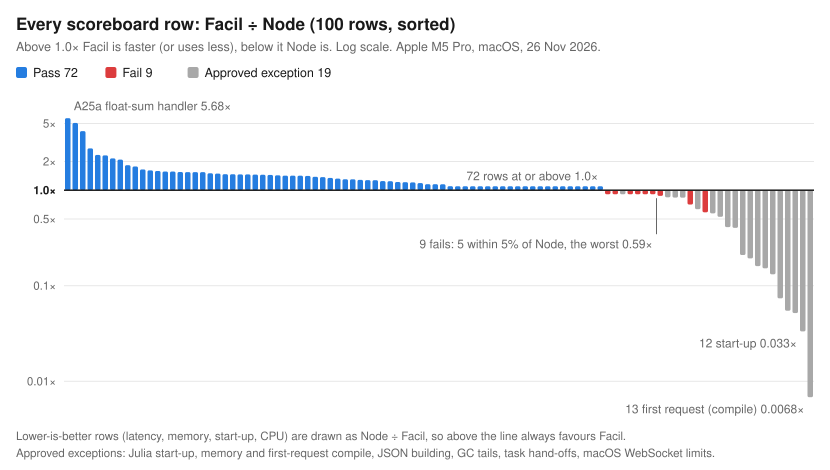

# [Benchmarks](@id benchmarks)

This page is the full record of how Facil performs against Node.js: all 100
rows of the scoreboard, including the ones where Facil is behind, the
conditions they were measured under, and how to reproduce them. For advice
drawn from these numbers, see [Performance tuning](../guide/performance.md).

Facil is compared against Node.js on every row of a scoreboard, using for each
row the fastest Node option for that job: `node:http` (with `cluster` for several
cores), `node:https`, uWebSockets.js or `ws` for WebSockets. The target for every
row is at least 1.0× Node.




The charts are drawn by `python3 bench/scoreboard/chart.py` from
`bench/scoreboard/chart_data.csv` (light and dark variants in
`docs/src/assets/`).

## Conditions

- Machine: Apple M5 Pro, 15 cores, macOS. Julia 1.13.0, Node v22.23.2.
- Client and server on the same machine, over loopback.
- 3 runs per cell. Each cell shows the median and, in brackets, the min–max.
- Before each run the driver checks that the machine is at least 90% idle, that
  the port belongs to the server it started, and that the endpoint returns the
  right status and body.
- Ratio is Facil/Node when higher is better (↑) and Node/Facil when lower is better
  (↓), so above 1 favours Facil.
- Clients, parameters and the Facil setup (handler mode, Julia threads, reactor
  threads) for each row are in `bench/scoreboard/rows.json`.
- Flags: `client` means the load client reached 90% of its cores, so the number
  is a lower bound; `errors` means non-2xx, reset or stuck responses were seen.
- Every Facil server runs with `JULIA_NUM_GC_THREADS=4`, the scoreboard default.
  See [One GC thread on Apple silicon](@ref bench-gc1) for the setting the
  deployment guide recommends on that hardware.

Each row comes from the full run of 26 November 2026 [1], except rows that a
rerun re-measured on both sides [2]: every row whose verdict differed from the
numbers published on 25 November, plus A17, 25, 32 and the start-up rows. The
Run column names the source. No Facil server crashed in either run.

## Scoreboard

72 rows pass, 9 fail and 19 are approved exceptions.

| Row | Name | Metric | Facil | Node | Node opponent | Ratio | Verdict | Flags | Run |
|---|---|---|---|---|---|---|---|---|---|
| A1 | Tiny reply, 1 core | rps (↑) | 248,626 (243,783–250,633) | 179,610 (179,593–180,785) | node:http | 1.38× | PASS |  | [1] |
| A2 | 150-byte JSON, 1 core | rps (↑) | 231,505 (224,879–233,091) | 158,620 (156,310–160,103) | node:http | 1.46× | PASS |  | [1] |
| A3 | POST echo | rps (↑) | 214,696 (213,187–214,894) | 136,737 (132,307–137,078) | node:http | 1.57× | PASS |  | [1] |
| A4 | 100 KB response | rps (↑) | 108,805 (98,797–110,992) | 85,383 (80,905–86,385) | node:http | 1.27× | PASS |  | [1] |
| A5 | 1 MB response | rps (↑) | 16,454 (16,161–16,641) | 15,899 (15,609–16,056) | node:http | 1.03× | PASS |  | [1] |
| A6 | CPU-bound handler (FNV 3x16 KB), 1 core | rps (↑) | 17,049 (17,041–17,084) | 16,546 (16,294–16,615) | node:http | 1.03× | PASS |  | [2] |
| A7 | CPU-bound handler, 2 cores | rps (↑) | 35,970 (35,253–36,718) | 36,054 (35,882–36,126) | cluster W=2 | 0.998× | FAIL |  | [2] |
| A8 | CPU-bound handler, 4 cores | rps (↑) | 68,475 (68,325–68,576) | 62,980 (62,973–63,220) | cluster W=4 | 1.09× | PASS |  | [1] |
| A9 | 1M requests, 10 per connection (client resets) | rps (↑) | 186,781 (185,654–187,692) | 146,217 (144,476–146,395) | node:http | 1.28× | PASS |  | [1] |
| A9-p99 | 1M requests, 10 per connection: p99 | p99_ms (↓) | 1.24 (1.22–1.25) | 6.28 (6.25–6.29) | node:http | 5.07× | PASS |  | [1] |
| A10 | 10,000 keep-alive connections: server CPU per request | cpu_us_per_req (↓) | 5.33 (5.3–6.65) | 8.61 (8.52–8.71) | node:http | 1.61× | PASS | facil:errors | [1] |
| A11 | gzip responses (100 KB JSON, level 6, off the event loop) | rps (↑) | 11,936 (11,393–12,069) | 7,501 (7,494–7,671) | node:http | 1.59× | PASS |  | [1] |
| A12a | Upload 1 KB, in memory | rps (↑) | 205,115 (202,356–205,174) | 139,311 (139,222–139,399) | node:http | 1.47× | PASS |  | [1] |
| A12b | Upload 64 KB, in memory | rps (↑) | 98,315 (97,974–107,729) | 67,957 (66,011–68,498) | node:http | 1.45× | PASS |  | [1] |
| A12c | Upload 1 MB, in memory | rps (↑) | 12,452 (12,337–12,934) | 8,812 (8,209–9,075) | node:http | 1.41× | PASS |  | [1] |
| A13a | TLS handshakes, ECDSA full, 10 clients | rps (↑) | 7,153 (7,102–7,240) | 6,780 (6,698–6,791) | node:https | 1.05× | PASS |  | [1] |
| A13b | TLS handshakes, RSA full, 10 clients | rps (↑) | 2,281 (2,270–2,288) | 2,216 (2,215–2,225) | node:https | 1.03× | PASS |  | [1] |
| A13c | TLS handshakes, RSA resumed, 10 clients | rps (↑) | 8,079 (8,008–8,237) | 7,848 (7,580–8,050) | node:https | 1.03× | PASS |  | [1] |
| A14 | WebSocket broadcast, 1,000 subscribers x 1,000 Hz | deliveries_per_s (↑) | 999,968 (676,551–999,968) | 768,182 (437,995–999,809) | uWebSockets.js | 1.30× | PASS |  | [2] |
| A15a | Streaming 10 x 1 KB chunks, no delay, 50 conns | rps (↑) | 165,013 (162,987–165,269) | 90,197 (89,707–91,424) | node:http | 1.83× | PASS | facil:client | [1] |
| A15b | Streaming 100 x 16 KB chunks, no delay | rps (↑) | 3,756 (3,708–3,866) | 3,701 (3,530–3,729) | node:http | 1.01× | PASS | facil:client, node:client | [1] |
| A15c | Streaming 10 x 1 MB chunks, no delay | rps (↑) | 1,296 (1,201–1,361) | 1,328 (1,237–1,381) | node:http | 0.98× | FAIL |  | [2] |
| A16 | Keep-alive, 1,000 connections | rps (↑) | 212,510 (207,328–216,380) | 135,408 (132,048–136,524) | node:http | 1.57× | PASS |  | [1] |
| A17 | Keep-alive, 10,000 connections | rps (↑) | 170,352 (88,516–424,968) | 115,816 (115,276–117,874) | node:http | 1.47× | PASS | facil:errors | [2] |
| A18 | Keep-alive, 5,000 connections: p99 | p99_ms (↓) | 28.3 (28.1–31.7) | 61 (61–61.4) | node:http | 2.15× | PASS |  | [1] |
| A19a | 2 request headers | rps (↑) | 214,848 (210,463–219,614) | 151,081 (150,638–151,343) | node:http | 1.42× | PASS |  | [1] |
| A19b | 12 request headers | rps (↑) | 180,306 (180,011–186,451) | 119,792 (118,284–120,369) | node:http | 1.50× | PASS |  | [1] |
| A19c | 40 request headers | rps (↑) | 95,105 (95,045–98,583) | 64,912 (64,296–65,541) | node:http | 1.47× | PASS |  | [1] |
| A19d | 100 request headers | rps (↑) | 31,167 (30,608–32,198) | 31,900 (31,435–32,069) | node:http | 0.98× | FAIL |  | [2] |
| A19e | 4 KB cookie | rps (↑) | 196,719 (195,725–197,672) | 143,261 (142,799–144,003) | node:http | 1.37× | PASS |  | [1] |
| A19f | 2 KB query string, parsed | rps (↑) | 38,700 (38,274–39,465) | 37,382 (37,025–37,971) | node:http | 1.03× | PASS |  | [1] |
| A20a | Pipelining depth 1 | rps (↑) | 231,263 (230,771–232,768) | 159,188 (159,140–159,385) | node:http | 1.45× | PASS | facil:client | [1] |
| A20b | Pipelining depth 4 | rps (↑) | 345,916 (338,098–352,093) | 223,286 (222,736–225,238) | node:http | 1.55× | PASS |  | [1] |
| A20c | Pipelining depth 16 | rps (↑) | 374,122 (370,291–377,155) | 241,882 (238,646–243,757) | node:http | 1.55× | PASS |  | [1] |
| A21 | Fixed 50k req/s: p99 | p99_ms (↓) | 0.0594 (0.0584–0.0601) | 0.0687 (0.0626–0.0723) | node:http | 1.16× | PASS |  | [1] |
| A22 | Fixed 100k req/s: p99 | p99_ms (↓) | 0.0597 (0.0587–65.2) | 0.0925 (0.0885–27.1) | node:http | 1.55× | PASS |  | [1] |
| A24 | JSON parse 1 KB POST | rps (↑) | 133,121 (130,994–135,378) | 109,214 (107,541–110,322) | node:http | 1.22× | PASS |  | [1] |
| A25a | Float sum handler (1e5 floats) | rps (↑) | 87,259 (86,535–87,603) | 15,351 (15,084–15,664) | node:http | 5.68× | PASS |  | [1] |
| A25b | FNV-1a over 4 KB handler | rps (↑) | 126,767 (126,245–127,965) | 101,975 (101,765–102,417) | node:http | 1.24× | PASS |  | [1] |
| A26 | Task-based tiny handler, 4 Julia threads | rps (↑) | 209,930 (209,861–211,323) | 181,827 (179,144–181,830) | node:http | 1.16× | PASS |  | [1] |
| A27 | HTTPS JSON, keep-alive | rps (↑) | 156,651 (154,736–157,866) | 128,953 (126,732–129,398) | node:https | 1.22× | PASS |  | [1] |
| A28 | Memory per idle WebSocket (10,000 open) | bytes_per_conn (↓) | 303 (279–392) | 634 (626–637) | uWebSockets.js | 2.09× | PASS |  | [1] |
| A29 | WebSocket echo 64 B, 100 connections | msgs_per_s (↑) | 281,369 (280,595–281,951) | 276,838 (276,117–277,179) | uWebSockets.js | 1.02× | PASS |  | [1] |
| A30 | WebSocket echo 64 B, 100 connections, vs ws | msgs_per_s (↑) | 281,369 (280,595–281,951) | 215,912 (214,497–218,086) | ws | 1.30× | PASS |  | [1] |
| 1 | CPU-bound handler, 8 cores | rps (↑) | 125,159 (125,154–125,492) | 121,321 (120,253–123,312) | cluster W=8 | 1.03× | PASS |  | [1] |
| 2 | Tiny reply (JSON), 4 cores | rps (↑) | 186,603 (186,274–186,753) | 179,389 (179,282–179,790) | cluster W=4 | 1.04× | PASS |  | [1] |
| 3 | Tiny reply (JSON), 8 cores | rps (↑) | 171,092 (169,940–171,488) | 169,515 (169,293–169,678) | cluster W=8 | 1.01× | PASS |  | [1] |
| 4 | Async (task) handler, tiny reply, 1 reactor + 2 Julia threads | rps (↑) | 217,575 (216,386–219,195) | 153,190 (152,143–154,667) | node:http | 1.42× | PASS |  | [1] |
| 5a | HTTPS 100 KB, no-copy body | rps (↑) | 37,215 (36,890–37,244) | 29,855 (29,648–29,920) | node:https | 1.25× | PASS |  | [1] |
| 5b | HTTPS 1 MB, no-copy body | rps (↑) | 4,648 (4,644–4,687) | 4,018 (4,006–4,049) | node:https | 1.16× | PASS |  | [1] |
| 6a | Paced streaming from a Julia task, 10 x 1 KB, 1 ms apart | rps (↑) | 19,072 (19,016–19,096) | 8,227 (8,223–8,302) | node:http | 2.32× | PASS | facil:client | [1] |
| 6b | Paced streaming from a Julia task, 100 x 16 KB, 1 ms apart | rps (↑) | 1,874 (1,870–1,875) | 800 (800–833) | node:http | 2.34× | PASS | facil:client | [1] |
| 6c | Paced streaming from a Julia task, 1000 x 1 KB, 1 ms apart | rps (↑) | 183 (183–183) | 66.7 (66.7–66.7) | node:http | 2.74× | PASS |  | [1] |
| 7-c10 | WebSocket echo 256 KB, 10 connections | msgs_per_s (↑) | 36,428 (36,071–36,693) | 37,049 (36,895–37,609) | uWebSockets.js | 0.98× | EXCEPTION |  | [1] |
| 7-c100 | WebSocket echo 256 KB, 100 connections | msgs_per_s (↑) | 26,764 (26,520–26,828) | 26,850 (22,381–27,243) | uWebSockets.js | 0.997× | FAIL |  | [2] |
| 7-c1000 | WebSocket echo 256 KB, 1000 connections | msgs_per_s (↑) | 17,120 (15,015–18,086) | 18,412 (17,321–19,415) | uWebSockets.js | 0.93× | FAIL |  | [1] |
| 7b-64 | WebSocket echo 64 B, 10 connections | msgs_per_s (↑) | 249,904 (249,680–250,963) | 244,756 (244,554–245,058) | uWebSockets.js | 1.02× | PASS |  | [1] |
| 7b-1k | WebSocket echo 1 KB, 10 connections | msgs_per_s (↑) | 247,508 (247,305–248,023) | 240,894 (240,613–241,137) | uWebSockets.js | 1.03× | PASS |  | [1] |
| 7b-16k | WebSocket echo 16 KB, 10 connections | msgs_per_s (↑) | 187,787 (187,497–188,286) | 183,543 (182,685–184,285) | uWebSockets.js | 1.02× | PASS |  | [1] |
| 8 | WebSocket permessage-deflate, 4 KB JSON echo, 100 connections | msgs_per_s (↑) | 58,510 (58,408–58,568) | 54,616 (53,924–54,762) | uWebSockets.js | 1.07× | PASS |  | [1] |
| 9 | 10 MB chunked upload, buffered | rps (↑) | 697 (692–752) | 486 (486–495) | node:http | 1.43× | PASS |  | [1] |
| 10 | Memory, idle | rss_mb (↓) | 387 (387–390) | 51 (50.8–51.1) | node:http | 0.13× | EXCEPTION |  | [1] |
| 10-sysimg | Memory, idle (Facil: PackageCompiler sysimage, /json-only server) | rss_mb (↓) | 335 (335–335) | 51 (50.8–51.1) | node:http | 0.15× | EXCEPTION |  | [1] |
| 11 | Memory, 10,000 keep-alive connections under load | rss_max_mb (↓) | 433 (418–440) | 248 (230–289) | node:http | 0.57× | EXCEPTION | facil:errors | [1] |
| 12 | Start-up to first response | startup_ms (↓) | 881 (879–883) | 29.3 (29.1–31.2) | node:http | 0.033× | EXCEPTION |  | [2] |
| 12-sysimg | Start-up to first response (Facil: PackageCompiler sysimage, /json-only server) | startup_ms (↓) | 397 (395–427) | 29.3 (29.1–31.2) | node:http | 0.074× | EXCEPTION |  | [2] |
| 12-json | Start-up to first response (Facil: plain julia, /json-only server) | startup_ms (↓) | 566 (555–583) | 29.3 (29.1–31.2) | node:http | 0.052× | EXCEPTION |  | [2] |
| 13 | First request | first_req_ms (↓) | 310 (310–316) | 2.11 (2.05–2.14) | node:http | 0.0068× | EXCEPTION |  | [1] |
| 13-sysimg | First request (Facil: PackageCompiler sysimage, /json-only server) | first_req_ms (↓) | 5.2 (4.93–5.3) | 2.1 (2.09–2.13) | node:http | 0.40× | EXCEPTION |  | [2] |
| 13-json | First request (Facil: plain julia, /json-only server) | first_req_ms (↓) | 5.11 (4.99–5.61) | 2.1 (2.09–2.13) | node:http | 0.41× | EXCEPTION |  | [2] |
| 14 | 200 slow-header connections (slowloris), held after 150 s | held (↓) | 0 (0–0) | 0 (0–0) | node:http | 1.00× | PASS |  | [1] |
| 15 | 200 slow readers of 8 x 1 MB: RSS growth | rss_growth_mb (↓) | 2.5 (2.1–2.8) | 10.4 (8.8–10.6) | node:http | 4.16× | PASS |  | [1] |
| 17a | Handler waits 1 ms (Facil.sleep), 100 connections | rps (↑) | 85,941 (84,396–86,036) | 55,382 (55,372–55,836) | node:http | 1.55× | PASS |  | [1] |
| 17b | Handler waits 1 ms (Facil.sleep), 1000 connections | rps (↑) | 164,400 (159,274–172,488) | 124,145 (123,037–129,893) | node:http | 1.32× | PASS |  | [1] |
| 18a | Handler waits 10 ms (Facil.sleep), 100 connections | rps (↑) | 9,795 (9,756–9,800) | 7,624 (7,580–7,627) | node:http | 1.28× | PASS |  | [1] |
| 18b | Handler waits 10 ms (Facil.sleep), 1000 connections | rps (↑) | 96,309 (96,261–96,391) | 81,000 (79,721–81,088) | node:http | 1.19× | PASS |  | [1] |
| 19 | Build a 50 KB JSON response | rps (↑) | 2,333 (2,192–2,361) | 12,071 (11,185–12,155) | node:http | 0.19× | EXCEPTION |  | [1] |
| 19a | Build a 1 KB JSON response | rps (↑) | 67,053 (66,208–67,298) | 127,284 (125,974–127,944) | node:http | 0.53× | EXCEPTION |  | [1] |
| 20 | Task-based handler on 1 Julia thread | rps (↑) | 244,754 (243,000–245,741) | 181,827 (179,144–181,830) | node:http | 1.35× | PASS | facil:client | [1] |
| 21a-p99 | 100 KB garbage per request at 10k req/s: p99 | p99_ms (↓) | 0.229 (0.229–0.23) | 0.145 (0.144–0.145) | node:http | 0.63× | EXCEPTION |  | [1] |
| 21a-p999 | 100 KB garbage per request at 10k req/s: p99.9 | p999_ms (↓) | 2.94 (2.89–2.96) | 0.161 (0.16–0.161) | node:http | 0.055× | EXCEPTION |  | [1] |
| 21b | 100 KB garbage per request, max rate | rps (↑) | 195,114 (191,997–196,821) | 133,225 (130,872–134,420) | node:http | 1.47× | PASS |  | [2] |
| 21b-p99 | 100 KB garbage per request, max rate: p99 | p99_ms (↓) | 1.33 (1.32–1.35) | 0.943 (0.919–1.16) | node:http | 0.71× | FAIL |  | [2] |
| 21c | 10 KB garbage per request at 10k req/s: p99.9 | p999_ms (↓) | 0.274 (0.27–0.279) | 0.161 (0.157–0.191) | node:http | 0.59× | FAIL |  | [2] |
| 22 | p99.9 at a light 10k req/s | p999_ms (↓) | 0.189 (0.175–0.215) | 0.165 (0.159–0.204) | node:http | 0.87× | FAIL |  | [2] |
| 23a | New connection per request, 100 clients | rps (↑) | 34,188 (33,718–35,414) | 35,183 (33,637–36,815) | node:http | 0.97× | FAIL | facil:errors, node:errors | [2] |
| 23b | New connection per request, 10 clients | rps (↑) | 35,644 (35,143–35,750) | 34,900 (34,564–36,175) | node:http | 1.02× | PASS |  | [2] |
| 24a | Upload 10 MB, default body handling (no spooling) | rps (↑) | 990 (954–997) | 662 (651–668) | node:http | 1.50× | PASS |  | [1] |
| 24b | Upload 100 MB, default body handling (no spooling) | rps (↑) | 121 (120–122) | 73.3 (72.6–73.8) | node:http | 1.65× | PASS |  | [1] |
| 25 | Upload 1 MB streamed through a task: requests per server CPU-second | req_per_cpu_s (↑) | 2,431 (2,404–2,444) | 11,585 (11,493–12,260) | node:http | 0.21× | EXCEPTION |  | [2] |
| 26 | WebSocket broadcast, 10,000 subscribers x 100 Hz | deliveries_per_s (↑) | 192,679 (160,612–206,117) | 228,400 (193,176–235,306) | uWebSockets.js | 0.84× | EXCEPTION | facil:errors, node:errors | [2] |
| 27 | Streamed gzip of 100 KB JSON | rps (↑) | 11,257 (11,232–11,336) | 6,348 (6,279–6,509) | node:http | 1.77× | PASS |  | [1] |
| 28a | Whole response 32 KB (gather-write) | rps (↑) | 147,285 (146,091–147,904) | 103,605 (102,069–106,496) | node:http | 1.42× | PASS | facil:client | [1] |
| 28b | Whole response 100 KB (gather-write) | rps (↑) | 84,843 (83,968–85,579) | 70,219 (68,800–72,533) | node:http | 1.21× | PASS | facil:client | [1] |
| 29 | Whole response 1 MB (gather-write) | rps (↑) | 6,367 (6,213–6,395) | 6,343 (6,321–6,387) | node:http | 1.00× | PASS | facil:client, node:client | [2] |
| 30a | Brotli level 4, 100 KB JSON, on the event loop | rps (↑) | 3,330 (3,304–3,332) | 3,159 (3,073–3,166) | node:http | 1.05× | PASS |  | [1] |
| 30b | zstd level 3, 100 KB JSON, on the event loop | rps (↑) | 9,151 (9,131–9,193) | 8,299 (8,235–8,338) | node:http | 1.10× | PASS |  | [1] |
| 31-p99 | Task handler at 10k req/s: p99 | p99_ms (↓) | 0.171 (0.171–0.171) | 0.143 (0.142–0.143) | node:http | 0.84× | EXCEPTION |  | [1] |
| 31-cpu | Task handler at 10k req/s: server cores used | server_cores (↓) | 0.179 (0.177–0.181) | 0.15 (0.148–0.15) | node:http | 0.84× | EXCEPTION |  | [1] |
| 32 | Longest single pause at 10k req/s, no garbage | max_ms (↓) | 2.61 (2.53–3.13) | 0.419 (0.415–3.06) | node:http | 0.16× | EXCEPTION |  | [2] |

### Failing rows

| Row | What | Ratio |
|---|---|---|
| A7 | CPU-bound handler, 2 cores, against Node `cluster` | 0.998× |
| A15c | Streaming 10 × 1 MB chunks, no delay | 0.98× |
| A19d | 100 request headers | 0.98× |
| 7-c100 | WebSocket echo 256 KB, 100 connections, against uWebSockets.js | 0.997× |
| 23a | New connection per request, 100 clients | 0.97× |
| 7-c1000 | WebSocket echo 256 KB, 1,000 connections, against uWebSockets.js | 0.93× |
| 22 | p99.9 at a light 10k req/s | 0.87× |
| 21b-p99 | 100 KB garbage per request, max rate: p99 | 0.71× |
| 21c | 10 KB garbage per request at 10k req/s: p99.9 | 0.59× |

The first five are within 5% of Node and were under 1.0× in both the full run
and the rerun, except A7 (1.04× in the full run). 7-c1000 is 7% behind. Rows 22,
21b-p99 and 21c are latency tails at a fixed or allocation-heavy load, where
Julia's GC pauses show: Facil's own numbers are the same or better than on 25
November (21c 0.32 → 0.27 ms, 22 0.25 → 0.19 ms), but the Node numbers published
then came from a slow Node run, and against Node's usual 0.16 ms they fail.

### Approved exceptions

These rows are approved exceptions to the "at least 1.0× Node" target
(2026-11-25). `bench/scoreboard/rows.json` gives each an `exception` reason, and
the scoreboard reports them as EXCEPTION, not FAIL, when they are under target.

| Rows | What | Reason |
|---|---|---|
| 10, 10-sysimg, 11 | Memory, idle and with 10,000 connections | Julia runtime start-up and memory cost |
| 12, 12-sysimg, 12-json, 13, 13-sysimg, 13-json | Start-up to first response, first request | Julia runtime start-up and first-request (compilation) cost |
| 19, 19a | Build a 50 KB / 1 KB JSON response | Cost of Julia's JSON library serialising the body, not of the server |
| 25 | 1 MB upload streamed through a task, per CPU-second | Task handlers pay two cross-thread hand-offs per chunk; `Stream(on_chunk)` beats Node |
| 31-p99, 31-cpu | Task handler at a light 10k req/s: p99, CPU | Two cross-thread hand-offs per request; `inline = true` beats Node |
| 7-c10 | WebSocket echo 256 KB, 10 connections | macOS kernel networking limit (bound by `writev`); recheck on Linux |
| 26 | WebSocket broadcast to 10,000 subscribers | macOS socket-memory exhaustion and retransmits; recheck on Linux |
| 21a-p99, 21a-p999, 32 | Tail latency and longest pause at 10k req/s | Julia GC pauses; still under target with `JULIA_NUM_GC_THREADS=4` |

The scoreboard starts every Facil server with `JULIA_NUM_GC_THREADS=4`
(`--facil-env KEY=VAL` overrides it); the table header records the value.

### Notes on some rows

- A17 (10,000 keep-alive connections): Facil's three runs ranged from 88,516 to
  424,968 req/s and some saw errors; treat the 1.47× median with caution.
- A14 (WebSocket broadcast, 1,000 subscribers): Facil reached the 1,000,000
  deliveries/s the row offers in both runs; uWebSockets.js ranged from 438k to
  1M, so the 1.30× mostly reflects Node's variance.
- Row 25 fell from 0.74× to 0.21× since 25 November: at the same request rate
  the Facil server now uses about 4.6 cores where it used 1.6. One GC thread
  gives the same number. The cause is not yet traced.
- Start-up (12, 12-sysimg, 12-json) is 15–26% slower than on 25 November in both
  runs; not investigated.
- Row 20 runs a task-handler server on one Julia thread. With one thread Facil
  runs handlers inline, so this row measures inline handlers.

## [One GC thread on Apple silicon](@id bench-gc1)

Julia 1.12 and 1.13 can crash in GC marking on Apple silicon when the collector
has more than one thread (JuliaLang/julia#65301; very rare), so the
[deployment guide](../guide/deployment.md) recommends `JULIA_NUM_GC_THREADS=1`
there. The scoreboard keeps four. The GC-sensitive rows with one GC thread [3],
both sides, against the four-thread numbers above:

| Row | What | Facil, 4 GC threads | Facil, 1 GC thread | Node | Ratio, 4 → 1 |
|---|---|---|---|---|---|
| 19 | Build a 50 KB JSON response (rps ↑) | 2,333 | 2,305 | 12,024 | 0.19× → 0.19× |
| 19a | Build a 1 KB JSON response (rps ↑) | 67,053 | 67,137 | 121,102 | 0.53× → 0.55× |
| 21a-p99 | 100 KB garbage per request at 10k req/s: p99 (ms ↓) | 0.229 | 2.15 | 0.144 | 0.63× → 0.067× |
| 21a-p999 | Same: p99.9 (ms ↓) | 2.94 | 7.18 | 0.163 | 0.055× → 0.023× |
| 21b | 100 KB garbage per request, max rate (rps ↑) | 195,114 | 184,515 | 136,051 | 1.47× → 1.36× |
| 21b-p99 | Same: p99 (ms ↓) | 1.33 | 2.33 | 0.97 | 0.71× → 0.42× |
| 21c | 10 KB garbage per request at 10k req/s: p99.9 (ms ↓) | 0.274 | 0.265 | 0.168 | 0.59× → 0.64× |
| 22 | p99.9 at a light 10k req/s (ms ↓) | 0.189 | 0.352 | 0.159 | 0.87× → 0.45× |
| 25 | 1 MB upload streamed through a task (requests per CPU-second ↑) | 2,431 | 2,498 | 12,033 | 0.21× → 0.21× |
| 32 | Longest single pause at 10k req/s (ms ↓) | 2.61 | 11.6 | 0.576 | 0.16× → 0.050× |

Throughput barely changes; tails under allocation grow, most on row 21a (p99
0.23 → 2.15 ms) and on the longest pause (2.6 → 11.6 ms). No verdict changes.
Node is the same in both columns; the Node numbers here are from run [3].

## Against HTTP.jl

HTTP.jl is not part of the scoreboard. The only measurement against it is from
the validation run, before the package was built, with a prototype Facil server
(1 thread, eager request objects) and `autocannon -c 100 -w 4`. The large-body
row used a copy path that the package no longer uses; compare row A4 above.

| Endpoint | Facil prototype | Node | HTTP.jl 2.16 | Facil / HTTP.jl |
|---|---|---|---|---|
| Empty reply | 236,422 | 163,904 | 52,540 | 4.50× |
| 150-byte JSON | 230,452 | 145,638 | 51,619 | 4.46× |
| JSON, 12 request headers | 190,426 | 123,424 | 46,884 | 4.06× |
| 100 KB response | 51,370 | 83,447 | 38,381 | 1.34× |

Requests per second, median of 3 runs [4].

## Reproducing

The scoreboard lives in `bench/scoreboard`. It needs Node.js, a C compiler and
the Facil build. Run it alone on a quiet machine; one full run takes a long time.

```sh
bench/scoreboard/build.sh                               # clients, pinned Node packages, payloads, certificates
bench/scoreboard/run.sh --list                          # the rows
bench/scoreboard/run.sh                                 # every row, both sides, 3 runs per cell
bench/scoreboard/run.sh --rows A1,A4 --runs 3 --side both
```

Results go to `bench/scoreboard/results/<timestamp>/table.md`, with every run in
`raw.jsonl` and server output in `logs/`. The driver uses ports 3510 (Node) and
3520 (Facil).

## Sources

Result directories are not kept in the repository. `bench/scoreboard/chart_data.csv`
holds every number above (`python3 bench/scoreboard/chart.py data` rebuilds it from
the result directories below), and `bench/scoreboard/RESULTS.md` holds the three runs as printed by the driver
and what changed since 25 November.

1. `bench/scoreboard/results/20261126-212620/table.md`: full run, all rows (runs per cell: 3; sides: both; machine: 15 cores; node v22.23.2; facil env: `JULIA_NUM_GC_THREADS=4`)
2. `bench/scoreboard/results/20261126-234001/table.md`: rerun of A6, A7, A14, A15c, A17, A19d, 7-c100, 12, 12-sysimg, 12-json, 13-sysimg, 13-json, 21b, 21b-p99, 21c, 22, 23a, 23b, 25, 26, 29, 32 (same settings)
3. `bench/scoreboard/results/20261127-000804/table.md`: rows 19, 19a, 21a–22, 25, 32 with `JULIA_NUM_GC_THREADS=1`
4. Validation run, not in the repository: `v3_speed/results/table.txt` in the planning session's scratch directory (rows `tiny`, `json`, `json12h`, `large`, client `c100w4`; Facil column `facil-c`).
